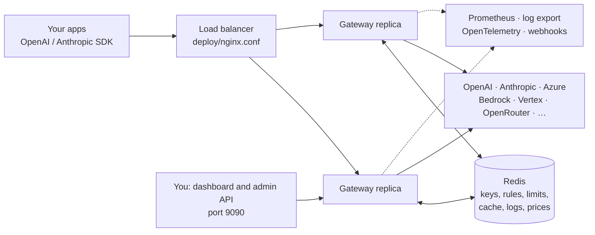

# AI Gateway

[](https://github.com/rockbye-kunal/ai-gateway/actions/workflows/ci.yml)

A self-hosted AI gateway written in Rust. It gives your apps one OpenAI-compatible API in front of OpenAI, Anthropic, Azure OpenAI, AWS Bedrock, Google Vertex AI, Gemini, Groq, OpenRouter and any other OpenAI-compatible provider, and adds the controls that Cloudflare AI Gateway and Vercel AI Gateway offer: routing and fallbacks, retries, rate and spend limits, caching, guardrails, cost tracking, request logs and a web dashboard.

Your apps keep using the OpenAI or Anthropic SDKs; you only change the base URL and the API key. The gateway runs as one or more replicas behind a load balancer, with Redis holding the state they share.

## Contents

- [Features](#features)
- [How it works](#how-it-works)
- [Quick start](#quick-start)
- [Calling the gateway](#calling-the-gateway)
- [Configuration](#configuration): [providers](#providers), [models](#choosing-a-model), [routing](#routing), [limits](#limits-budgets-and-alerts), [keys and BYOK](#keys-provider-keys-byok-and-data-handling), [guardrails](#guardrails), [caching](#caching), [prices](#model-prices), [logs](#logs-export-and-tracing)
- [API reference](#api-reference)
- [Dashboard and admin API](#dashboard-and-admin-api)
- [Running in production](#running-in-production)
- [Development](#development)
- [How it compares](#how-it-compares)

## Features

| Area | What you get |
|---|---|
| **APIs** | OpenAI Chat Completions (with streaming), Responses, Embeddings, Images, Moderations, Rerank, Audio speech and Realtime (WebSockets); Anthropic Messages; `/native/<provider>/<path>` passthrough for any other provider endpoint; `/v1/models` |
| **Providers** | Any OpenAI-compatible API (OpenAI, Gemini, Groq, Together, Mistral, vLLM, Ollama, OpenRouter…), Azure OpenAI, Anthropic, AWS Bedrock (Converse API, SigV4 signing, every AWS credential source) and Google Vertex AI (Gemini and partner models, Claude in Anthropic's format). Anthropic and Bedrock are translated to and from the OpenAI format, including tools, images and streaming |
| **Routing** | Named routes with fallbacks, weighted A/B splits with session affinity, fastest-first and cheapest-first strategies, conditional branches on key, user, tags or metadata, per-request fallback models, provider `order`/`only`/`sort`, and model rewrite and deny rules you can change live |
| **Reliability** | Retries with configurable backoff, per-provider and per-request timeouts, stream idle timeout, circuit breakers with alerts, fallback on 5xx, timeouts, 429 and rejected credentials |
| **Cost** | Costs worked out automatically from a public price list (LiteLLM's, refreshed daily, or a local file), including prompt-cache read and write rates; your own prices and overrides take priority |
| **Limits and spend** | Per-key requests per minute and token budgets; request, token and dollar limits per minute, hour, day, week or month, split by key, user, model, provider or any metadata field; signed webhook alerts at thresholds |
| **Caching** | Exact-match cache for normal and streaming responses, per key, with per-request TTL, skip and custom cache key; automatic Anthropic prompt caching |
| **Security** | Hashed client keys, keys and routing rules managed live, bring-your-own provider keys (per request, or stored encrypted), zero data retention and no-training filters, guardrails and DLP (regex detectors and moderation models), audit log |
| **Observability** | Request log with every provider attempt, tokens (cached and reasoning too), cost, time to first token, tokens per second, user, tags, metadata and feedback; optional prompts and responses; usage reports; NDJSON log export; OpenTelemetry traces; Prometheus metrics |
| **Operations** | Web dashboard, admin API, hot config reload (SIGHUP or API), `/healthz` and `/readyz`, graceful shutdown that lets streams finish and flushes usage writes |

## How it works



Every API request goes through the same steps (`src/proxy.rs`):

1. **Authenticate** the client key and take its concurrency slot, before reading the body.
2. **Read options** from headers and `providerOptions.gateway`, which is removed from the body.
3. **Validate** the body for the API being called.
4. **Pick targets**: routing rules, then the route's branches and strategy, fallback models, `only`, `order`, `sort`, zero-data-retention and training filters, and which providers support this API.
5. **Check limits**: the key's rate and budget, then the configured limits.
6. **Run guardrails**: regex rules (block, redact or flag), then moderation models.
7. **Look up the cache**.
8. **Call providers**: for each target, per-provider limits, the circuit breaker, credentials (request, stored or config key), retries with backoff, and fallback to the next target on failure.
9. **Respond**: translate or pass through, run response guardrails, store in the cache. After the response, record the log, usage and cost, charge limits, send alerts and export.

## Quick start

You need Rust 1.89 or newer. Redis is optional for a single replica (the in-memory store is the default) and required for more than one.

```bash
cargo build --release

# 1. Create keys. Give api_key to the client; put only key_sha256 in the config.
./target/release/ai-gateway generate-key              # a client key
./target/release/ai-gateway generate-key              # the admin token for the dashboard
./target/release/ai-gateway generate-encryption-key   # optional: lets the dashboard store provider keys

# 2. Configure
cp config.example.yaml config.yaml                    # then edit providers, routes and keys
export OPENROUTER_API_KEY=... REDIS_URL=rediss://... ADMIN_TOKEN_SHA256=...
./target/release/ai-gateway check-config config.yaml

# 3. Run
./target/release/ai-gateway serve config.yaml
```

The client API listens on `0.0.0.0:8080` and the dashboard and admin API on `127.0.0.1:9090` (change them under `server:`). Open `http://localhost:9090/` and sign in with the admin token.

To run two replicas, Redis and nginx together the way production looks:

```bash
cp config.example.yaml config.yaml
export REDIS_PASSWORD=... OPENROUTER_API_KEY=...
docker compose up --build
```

## Calling the gateway

```python
from openai import OpenAI
client = OpenAI(base_url="https://gateway.example.com/v1", api_key="gw_...")
client.chat.completions.create(model="smart", messages=[{"role": "user", "content": "Hello"}])
```

```python
from anthropic import Anthropic
client = Anthropic(base_url="https://gateway.example.com", api_key="gw_...")
client.messages.create(model="anthropic/claude-sonnet-4.5", max_tokens=512, messages=[{"role": "user", "content": "Hello"}])
```

Response headers tell you what happened: `x-request-id` (also `x-gateway-generation-id`), `x-gateway-provider`, `x-gateway-model`, `x-gateway-cache: HIT|MISS` (also `cf-aig-cache-status`), and `x-gateway-guardrails` when a rule matched.

## Configuration

Everything is in one YAML file; `config.example.yaml` is a commented starting point. `${VAR}` is replaced with the environment variable `VAR`. Most changes take effect with a [reload](#reloading-configuration), no restart needed.

### Providers

```yaml
providers:
  openai:
    kind: openai                  # any OpenAI-compatible API
    base_url: https://api.openai.com/v1
    api_key: ${OPENAI_API_KEY}
    timeout_secs: 120
    max_retries: 2
  anthropic:
    kind: anthropic
    base_url: https://api.anthropic.com/v1
    api_key: ${ANTHROPIC_API_KEY}
    auto_prompt_cache: true       # add prompt-caching markers automatically
  azure:
    kind: azure                   # the route target's model is the deployment name
    base_url: https://YOUR-RESOURCE.openai.azure.com/openai/deployments
    api_key: ${AZURE_OPENAI_API_KEY}
    api_version: "2024-10-21"
  bedrock:
    kind: bedrock
    region: us-east-1             # or AWS_REGION
    # Optional. Without keys the standard AWS chain is used: AWS_ACCESS_KEY_ID/…,
    # EKS web identity (IRSA), ECS task role, then the EC2 instance role (IMDSv2).
    # aws_access_key_id: ${AWS_ACCESS_KEY_ID}
    # aws_secret_access_key: ${AWS_SECRET_ACCESS_KEY}
    # Or a Bedrock API key, sent as a bearer token:
    # api_key: ${AWS_BEARER_TOKEN_BEDROCK}
  vertex:
    kind: vertex
    project: my-gcp-project
    region: us-central1           # or global
    # Optional. Without these, GOOGLE_APPLICATION_CREDENTIALS and then the
    # metadata server (GKE, Cloud Run, GCE) are used.
    # credentials_file: /secrets/vertex-sa.json
```

Other provider settings: `stream_idle_timeout_secs`, `breaker_failure_threshold`, `breaker_open_secs`, `default_max_tokens`, `extra_headers`, `zero_data_retention`, `no_prompt_training`, `allow_client_keys`, `pricing_prefix` and `allow_insecure_http` (plain HTTP to a non-local host, such as an in-cluster vLLM).

- **Bedrock** chat goes through the Converse API (`converse` and `converse-stream`), so any Bedrock chat model works: `bedrock/us.anthropic.claude-sonnet-4-5-20250929-v1:0`, `bedrock/amazon.nova-pro-v1:0`, or an inference profile ARN. Tools, base64 images, system prompts, stop sequences and prompt caching are translated; `additionalModelRequestFields` and `guardrailConfig` pass through. Other Bedrock APIs (InvokeModel, embeddings) are available at `/native/bedrock/...` and signed for you.
- **Vertex**: Gemini and other publisher models use Vertex's OpenAI-compatible endpoint (`vertex/gemini-2.5-flash` is sent as `google/gemini-2.5-flash`; give other publishers in full, like `vertex/meta/llama-...`). Models starting with `claude-` use Anthropic's format on Vertex, for both `/v1/chat/completions` and `/v1/messages`. Anything else is reachable at `/native/vertex/projects/...`.
- AWS and Google credentials are cached until shortly before they expire.

### Choosing a model

The `model` a client sends can be:

- a **route name** from the config (`smart`), which brings its fallbacks and strategy;
- `provider/model` for a configured provider (`openai/gpt-4o`, `anthropic/claude-sonnet-4.5`);
- anything else, sent unchanged to `default_provider` (for example any OpenRouter model).

Each key lists what it may use in `allowed_models`: route names, `provider/model`, `provider/*`, or `*`.

### Routing

```yaml
routes:
  - name: smart
    strategy: weighted          # fallback (default) | weighted | latency | cost
    targets:
      - provider: anthropic
        model: claude-sonnet-4.5
        weight: 90
      - provider: openai
        model: gpt-4o
        weight: 10
    branches:                   # first match wins; otherwise the targets above
      - when:
          metadata.plan: free   # or {in: [...]}, {ne: ..}, {not_in: [...]}, {exists: true}
        strategy: cost
        targets:
          - provider: openai
            model: gpt-4o-mini
```

- `fallback` tries targets in the order listed; the rest are fallbacks.
- `weighted` picks the first target by weight; a request with a session id always lands on the same one. Weight 0 makes a target fallback-only.
- `latency` puts the target with the fastest recent time to first token first. Untried targets go first so they get measured, and 5% of requests try the runner-up to keep measurements fresh.
- `cost` puts the cheapest target first, using the same prices as [cost tracking](#model-prices); targets with no known price go last.
- Branch conditions can use `key`, `user`, `tags` and `metadata.<name>`.

Routing rules rewrite or deny models before routing, and apply to fallbacks too. Put them in the config, or manage them live from the dashboard (`/api/rules`):

```yaml
routing_rules:
  - source: openai/gpt-3.5-turbo   # a model, provider/* or *
    action: rewrite
    destination: openai/gpt-4o-mini
  - source: openai/o1-preview
    action: deny
    reason: retired model           # shown to clients in the 403
```

### Limits, budgets and alerts

```yaml
limits:
  - name: per-user-requests
    kind: requests                # requests | tokens | cost (USD)
    limit: 60
    window: minute                # minute | hour | day | week | month (UTC)
    per: user                     # global | key | user | model | provider | metadata.<name>
    sliding: true                 # requests only: smooth the window edge
  - name: monthly-spend-per-key
    kind: cost
    limit: 500
    window: month
    per: key
    keys: [acme-prod]             # optional filter
    models: ["openai/*"]          # optional filter
alerts:
  webhook_url: https://hooks.example.com/ai-gateway
  webhook_secret: ${ALERT_SECRET}   # HMAC-SHA256 of the body in x-gateway-signature
  thresholds: [0.8, 1.0]
```

Over a limit, requests get `429` with code `limit_exceeded` and a `Retry-After` header until the window resets. Token and cost limits are charged when a request finishes, so concurrent requests can overshoot slightly (the same soft cap as Cloudflare and Vercel). A `per: provider` limit skips that provider and falls back instead of failing. Alerts fire once per limit, window and threshold across all replicas; the webhook also receives `provider.circuit_open` events. Per-key `requests_per_minute` and `daily_token_budget` are set on the key itself.

### Keys, provider keys (BYOK) and data handling

- **Client keys** come from the config file or the dashboard. Dashboard keys are stored as hashes in Redis and reach every replica within `admin.key_refresh_secs`.
- **Provider keys** come from the config file, from the dashboard (encrypted with AES-256-GCM using `admin.encryption_key`, stored in Redis), or per request in `providerOptions.gateway.byok`. A wrong key sent by the client returns `401 provider_key_rejected`; a wrong gateway key falls back to the next target. Set `allow_client_keys: false` on a provider to refuse client keys. The log records which kind was used (`config`, `stored`, `request`).
- **Zero data retention**: mark providers with `zero_data_retention: true` (and `no_prompt_training: true`). A key with `zero_data_retention: true`, or a request with `zeroDataRetention`, only goes to those providers, is never cached, and its prompts and responses are never logged or exported. `disallowPromptTraining` filters on `no_prompt_training`.

### Guardrails

```yaml
guardrails:
  rules:
    - name: no-cards
      builtin: credit_card     # Luhn-checked
      action: block            # block | redact | flag
      apply_to: request        # request | response | both (default)
    - name: emails
      builtin: email
      action: redact           # replaced with [REDACTED:emails]
    - name: injection
      builtin: prompt_injection
      action: flag
    - name: violence
      moderation:              # a moderation model
        provider: openai       # an openai-kind provider with /moderations
        model: omni-moderation-latest
        categories: [violence, hate, self-harm]   # empty = any flagged category
        threshold: 0.8         # optional; default is the model's own decision
        fail_open: true
      action: block
    - name: codename
      pattern: "(?i)project\\s+falcon"
      action: block
```

Built-in detectors: `email`, `credit_card`, `phone_in`, `phone_intl`, `aadhaar`, `pan`, `us_ssn`, `iban`, `ipv4`, `api_key`, `prompt_injection`. Rules see chat and Messages turns and system prompts, Responses, embeddings and moderation `input`, image `prompt` and rerank `query`/`documents`. Blocked requests get `400 content_blocked` and never reach a provider. Response rules run on non-streaming responses. Matches appear in `x-gateway-guardrails`, the log and `gateway_guardrail_hits_total`.

### Caching

```yaml
cache:
  enabled: true
  ttl_secs: 300
```

Identical requests from the same key, routed to the same targets, are served from the cache, including streams (replayed as the same SSE). Use the `cache-ttl`, `skip-cache` and `cache-key` options per request. Images and speech are not cached. Anthropic prompt caching is separate: set `auto_prompt_cache: true` on the provider or send `caching: auto`; cached input tokens show up in the log and reports.

### Model prices

Every request gets a cost, used by spend limits, reports, the dashboard and the `cost` routing strategy. The cost comes from the first of these that applies:

1. a `custom-cost` option on the request;
2. the cost the provider reported (OpenRouter);
3. a price: `price_input_per_mtok` / `price_output_per_mtok` on the route target, then `pricing.overrides` (keyed `provider/model` or `model`), then the public price list, matched by provider type, host and model (dated, regional and versioned names fall back to their base model).

```yaml
pricing:
  enabled: true                 # default
  refresh_hours: 24
  # url: <LiteLLM-format JSON>  # default: LiteLLM's public list
  # file: prices.json           # for servers without internet access
  overrides:
    openai/my-fine-tune: {input_per_mtok: 3.0, output_per_mtok: 12.0}
```

Prompt-cache reads and writes are priced at their own rates when the list has them. Replicas share the list through Redis, so only one needs to download it. The Providers & routes page shows the price used for every route target, and so do `GET /api/pricing` and `POST /api/pricing/refresh`. For an OpenAI-compatible provider the list doesn't recognise by its host, set `pricing_prefix` (for example `openrouter/`).

### Logs, export and tracing

```yaml
logging:
  enabled: true
  max_entries: 10000          # searchable log size
  capture_bodies: false       # prompts and responses
  detail_ttl_secs: 604800
  report_retention_days: 90
  export:                     # NDJSON batches of log entries ("logpush")
    url: https://logs.example.com/ingest
    headers: {Authorization: "Bearer ${LOG_TOKEN}"}
    include_bodies: false
  otlp:                       # one trace per request, a span per provider attempt
    endpoint: http://otel-collector:4318
    service_name: ai-gateway
```

Each request records the key, user, tags, metadata, model and provider, status, every provider attempt, prompt, completion, cached and reasoning tokens, cost, latency, time to first token, tokens per second, guardrail matches and feedback. Exports and traces go through bounded queues and are dropped (and counted) rather than slowing requests down. OpenTelemetry spans use the `gen_ai.*` conventions and continue the client's `traceparent`.

## API reference

| Endpoint | Served by |
|---|---|
| `POST /v1/chat/completions` | Every provider (Anthropic and Bedrock are translated) |
| `POST /v1/responses` | OpenAI-compatible providers, streams passed through event by event |
| `POST /v1/messages` | Anthropic, and Claude on Vertex; native format with `anthropic-version`/`anthropic-beta` forwarded |
| `POST /v1/embeddings`, `/v1/images/generations` | OpenAI-compatible and Azure |
| `POST /v1/moderations`, `/v1/rerank`, `/v1/audio/speech` | OpenAI-compatible |
| `GET /v1/realtime?model=…` | WebSocket relay to OpenAI-compatible realtime APIs; browsers can authenticate with the `openai-insecure-api-key.<key>` subprotocol |
| `ANY /native/<provider>/<path>` | Any endpoint of a configured provider, in its own format; the gateway adds the provider's credentials |
| `GET /v1/models` | Routes this key may use, with prices |
| `GET /v1/report`, `GET /v1/generation?id=`, `POST /v1/feedback` | The calling key's own usage report, request lookup and feedback |

All of them get authentication, permissions, limits, guardrails, logging and usage tracking. Native passthrough is not cached, and only `deny` rules (and same-provider rewrites) apply to it, because its bodies are in each provider's own format.

### Per-request options

Send options as headers (`x-gateway-<name>` or Cloudflare's `cf-aig-<name>`) or in the body under `providerOptions.gateway` (Vercel's shape). `providerOptions` is removed before the request reaches a provider.

| Header | Meaning |
|---|---|
| `metadata` | JSON object of strings, numbers or booleans (up to 20 keys), stored in the log and usable in routing and limits |
| `cache-ttl` / `skip-cache` / `cache-key` | Cache this response for N seconds / bypass the cache / use your own cache key |
| `collect-log` | `false` keeps the request out of the request log (analytics still count it) |
| `request-timeout` | Milliseconds for the whole request (capped at the server limit) |
| `max-attempts`, `retry-delay`, `backoff` | Attempts per target (1-10), first retry delay in ms, `constant`/`linear`/`exponential` |
| `custom-cost` | `{"per_token_in": .., "per_token_out": ..}` or `{"total_cost": ..}` in USD |
| `event-id` | Your own id, stored and searchable |

Also `x-session-id` (session affinity), `ai-reporting-user`, `ai-reporting-tags` (comma separated), and W3C `traceparent`. The OpenAI `user` field is the reporting user unless a header sets one.

```json
"providerOptions": {"gateway": {
  "order": ["anthropic", "openai"],
  "only": ["anthropic", "openai"],
  "models": ["openai/gpt-4o", "google/gemini-2.5-flash"],
  "sort": "ttft",
  "user": "user-123",
  "tags": ["feature:chat", "env:prod"],
  "metadata": {"plan": "free"},
  "sessionId": "conversation-42",
  "caching": "auto",
  "zeroDataRetention": true,
  "disallowPromptTraining": true,
  "byok": {"openai": [{"apiKey": "sk-..."}]}
}}
```

`models` are fallbacks tried after the requested model. `order` puts those providers first; `only` allows nothing else. `sort` is `cost`, `ttft` or `tps` (from recent measurements on this replica). `caching: auto` adds Anthropic prompt-caching markers.

## Dashboard and admin API

The admin port serves the dashboard at `/` and a JSON API under `/api`, both protected by the admin token (`admin.token_sha256`).

Dashboard pages: **Overview** (traffic, failures, tokens, spend, latency and time to first token, with breakdowns by model, user, tag, API, key and provider), **Requests** (search and filters, full detail with every provider attempt, prompts and responses, feedback, delete), **Usage reports** (by day, model, provider, key, user, tag, credential and ZDR; CSV download), **API keys**, **Routing rules**, **Limits**, **Providers & routes** (health, live latency and throughput, model prices, stored provider keys, reload) and **Audit log**.

| Admin API | Purpose |
|---|---|
| `GET /api/overview?range=24h` | Totals, time series, breakdowns |
| `GET /api/logs?status=&tenant=&model=&user=&tag=&endpoint=&metadata=k%3Dv&q=` / `DELETE` with the same filters | Search or delete logged requests |
| `GET /api/logs/{id}`, `POST /api/logs/{id}/feedback` | One request; rate it (`rating` 1/0/-1, `score` 0-100, `comment`) |
| `GET /api/report?start_date=&end_date=&group_by=` | Usage report (same fields as Vercel's reporting API) |
| `GET/POST /api/keys`, `DELETE /api/keys/{name}` | Client keys |
| `GET/POST /api/rules`, `PATCH/DELETE /api/rules/{id}` | Routing rules |
| `GET /api/provider-keys`, `PUT/DELETE /api/provider-keys/{provider}` | Stored provider keys |
| `GET /api/limits`, `GET /api/audit`, `GET /api/config`, `POST /api/reload` | Limit usage, audit log, configuration and health, reload |
| `GET /api/pricing`, `POST /api/pricing/refresh` | Price list status and the price of every route target; download it again now |

## Running in production

### Behind a load balancer

- Use `store.backend: redis`. Limits, budgets, cache, logs, keys, rules, stored provider keys and the price list are then shared by every replica. Use `rediss://` for TLS to managed Redis.
- Terminate TLS at the load balancer. The gateway listens on plain HTTP inside your network.
- Point the health check at `GET /readyz` on the API port. It doesn't check Redis on purpose: a Redis outage would otherwise mark every replica unhealthy at once. Watch `gateway_store_errors_total` instead.
- On SIGTERM the gateway fails `/readyz` for `shutdown_drain_secs`, stops accepting connections, gives in-flight requests up to `shutdown_grace_secs`, then flushes usage writes and log exports.
- Turn off response buffering and set a long read timeout on the load balancer for SSE and WebSockets (see `deploy/nginx.conf`).
- Keep `admin_listen` on a private network.
- Circuit breakers and latency measurements are per replica on purpose.

### Reloading configuration

Send `SIGHUP` or call `POST /api/reload` to re-read the config file. Providers, routes, guardrails, limits, routing rules, config keys, cache, logging and pricing options change immediately; circuit-breaker state and per-key concurrency carry over when a provider or key is unchanged. Listen addresses, the store, the admin token and log export endpoints need a restart. A config that fails validation is rejected and the running one stays.

### When Redis is unreachable

`store.on_error` decides: `closed` (default) rejects requests that need a limit or budget check with 503; `open` lets them through without limits. The cache always fails open.

### Rotating a client key

Generate a new key, set its hash as `key_sha256`, and move the old hash into `previous_key_sha256`. Reload, let the client switch, then remove the old hash. Both keys share the key's limits, budget and metrics during the overlap. Dashboard keys are rotated by creating a new key and revoking the old one.

### Metrics

Served on `admin_listen` at `/metrics`: `gateway_requests_total`, `gateway_request_duration_seconds`, `gateway_time_to_first_token_seconds`, `gateway_tokens_total`, `gateway_cost_microdollars_total`, `gateway_upstream_errors_total`, `gateway_upstream_skipped_total`, `gateway_circuit_open`, `gateway_rejected_total{reason}`, `gateway_cache_total`, `gateway_store_errors_total`, `gateway_guardrail_hits_total`, `gateway_guardrail_errors_total`, `gateway_alerts_total`, `gateway_export_batches_total`, `gateway_export_dropped_total`, `gateway_config_reloads_total`, `gateway_pricing_refresh_total`.

## Development

### Project layout

| Path | What's in it |
|---|---|
| `src/main.rs`, `src/app.rs` | Command line, startup, shared state, HTTP routers, background loops |
| `src/config.rs` | Every config field, its default and validation |
| `src/proxy.rs` | The request pipeline: auth, options, target planning, limits, guardrails, cache, retries and fallback |
| `src/options.rs`, `src/rules.rs`, `src/limits.rs`, `src/guardrails.rs` | Per-request options, routing rules, limits, guardrails |
| `src/providers/` | Provider adapters: `mod.rs` (building and sending requests), `openai.rs`, `anthropic.rs`, `bedrock.rs` |
| `src/aws.rs`, `src/gcp.rs` | AWS SigV4 signing, credentials and event streams; Google access tokens |
| `src/sse.rs`, `src/native.rs`, `src/realtime.rs` | Streaming, native passthrough, WebSocket relay |
| `src/usage.rs`, `src/pricing.rs` | Token and cost accounting, the price list |
| `src/store.rs`, `src/auth.rs`, `src/secrets.rs`, `src/breaker.rs` | Redis or memory storage, client keys, encryption, circuit breaker |
| `src/logs.rs`, `src/export.rs`, `src/alerts.rs`, `src/metrics.rs` | Request log and reports, log export and OpenTelemetry, webhooks, metrics |
| `src/admin.rs`, `dashboard/` | Admin API and the web dashboard |
| `tests/` | End-to-end tests against mock providers |
| `deploy/`, `Dockerfile`, `docker-compose.yml` | nginx config and container setup |

### Testing

```bash
cargo fmt --check
cargo clippy --all-targets -- -D warnings
cargo test                                                        # in-memory store
AIGW_TEST_REDIS_URL=redis://127.0.0.1:6379/0 cargo test           # against real Redis
```

`tests/e2e.rs`, `tests/parity.rs` and `tests/cloud.rs` start a real gateway in front of mock OpenAI, Anthropic, Bedrock (checking every SigV4 signature and decoding AWS event streams), Vertex (with a Google token endpoint), moderation, image, speech, rerank and realtime WebSocket servers, plus webhook, log-export and OTLP collectors and a price list.

CI (`.github/workflows/ci.yml`) runs formatting, clippy, the tests with the in-memory store and against Redis, a release build and a Docker build on every push. `.github/workflows/live.yml` also runs the gateway against the real OpenRouter API when the `OPENROUTER_API_KEY` repository secret is set.

## How it compares

Matches Cloudflare AI Gateway and Vercel AI Gateway on: one OpenAI-compatible API, the Responses and Anthropic Messages APIs, provider-native endpoints, realtime WebSockets, caching with per-request controls, rate and spend limits with alerts, dynamic and conditional routing, fallbacks and retries, provider ordering and filtering, routing rules, BYOK, zero data retention, guardrails and DLP, request logs with metadata and feedback, usage reporting, generation lookup, log export, OpenTelemetry, analytics, automatic pricing and a dashboard.

Not included:

- **Unified billing** (one invoice for every provider): that needs a billing relationship with each provider, which a self-hosted gateway doesn't have. Use your own provider accounts.
- **Semantic caching**: the cache is exact-match.
- **Automated evaluations and log classification** with an LLM judge; human feedback and per-model comparisons are included.
- **Translating** the Messages API to non-Anthropic models, or the Responses API to non-OpenAI models; each goes to providers that speak it natively.
- Response guardrails on streamed responses, multipart uploads (image edits, transcription) through the unified API (use `/native/...`), and video generation.
